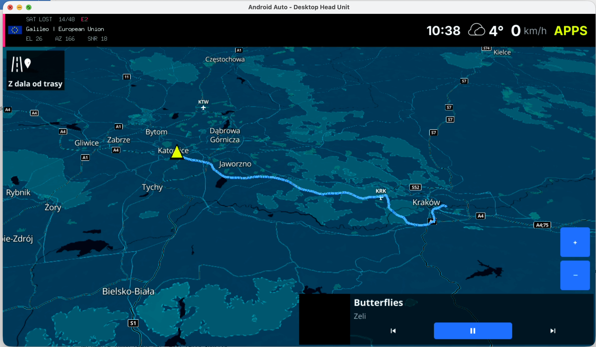
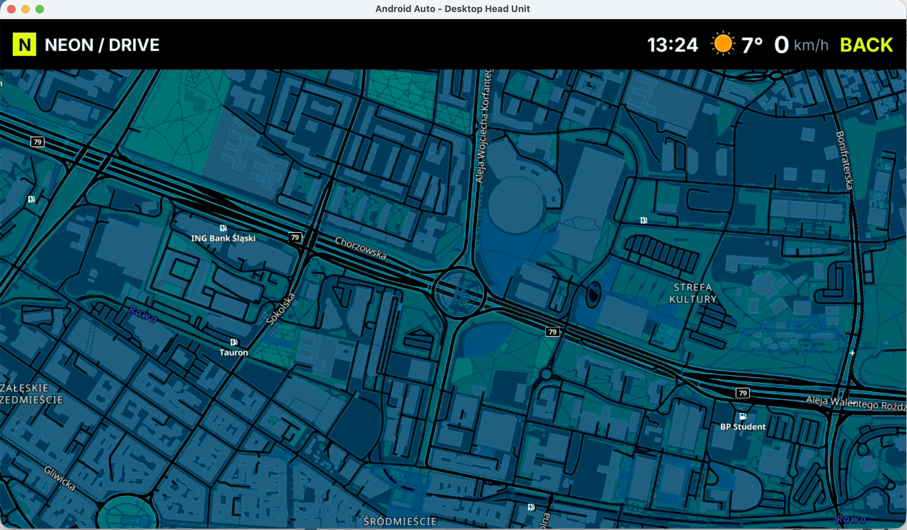
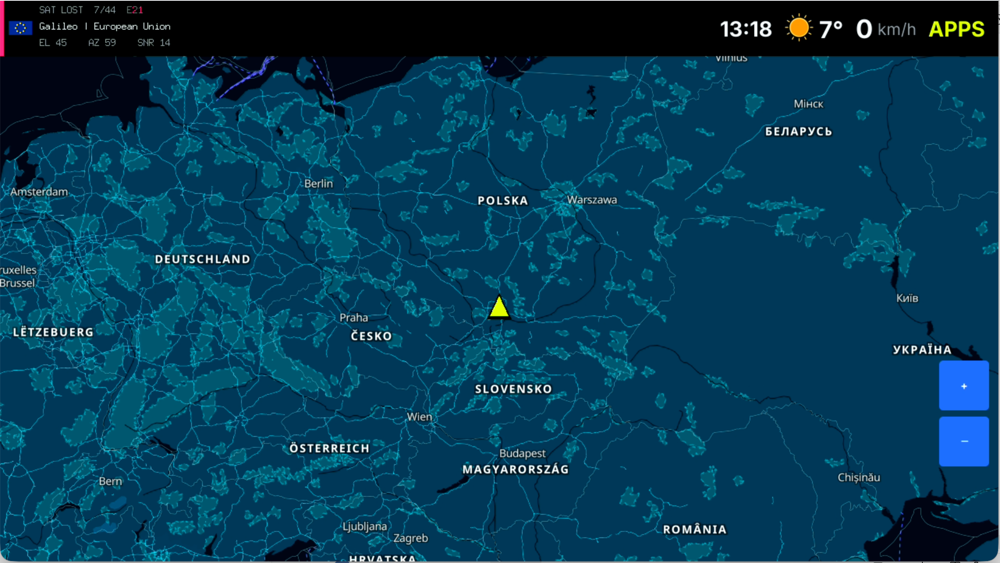

# Cargadgetd maps

Drive map for cargadgetd. The picture is OSM Scout tiles, or a MapLibre still
when the plugin is built with `-tags maplibrenative`.

## Screenshots



|  | |
|:-:|:-:|
|  |  |

Shell visible above: [Neon](https://github.com/MrCyjaneK/cargadgetd_shell_neon)

Apps visible above:

 - [Music](https://github.com/MrCyjaneK/cargadgetd_app_music)
 - [Area](https://github.com/MrCyjaneK/cargadgetd_app_area)


```bash
sfosbuild 5.1.0.11 aarch64 ./rpm/cargadgetd-maps.spec
```